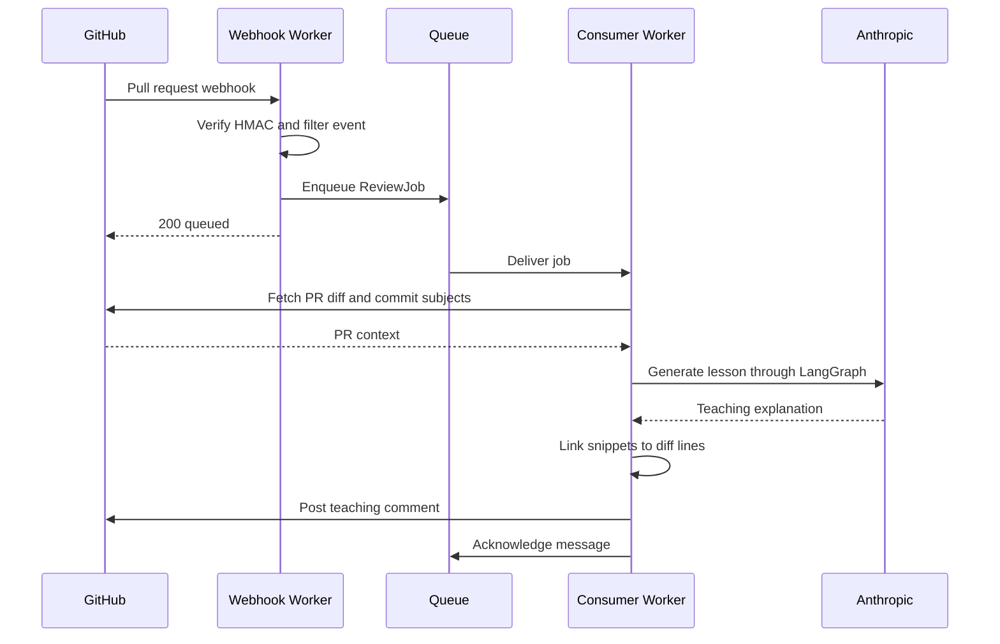

# Literate Reviews

A GitHub App that posts a short teaching comment on opened and synchronized
pull requests. It explains 1–3 concepts, techniques, patterns, or libraries.
It bases each lesson on the PR description, commit subjects, and diff.
Each lesson quotes short verbatim snippets and links them to the PR diff.
Matched snippets point to precise lines; otherwise the link opens the file.
Use it to build a shared understanding of the changes.

## What a lesson looks like

An illustrative excerpt for a PR that adds webhook verification (actual wording varies):

> ### 1. Authenticate the webhook with HMAC
>
> HMAC lets you check that the sender signed the body with your shared webhook
> secret. Check the raw body before you parse it: even a whitespace change
> produces a different signature.
>
> From `src/receiver/webhook.ts`:
>
> ```ts
> if (!(await verifyHmac(secret, body, sig))) {
>   return { status: 401, body: "bad signature" };
> }
> ```

## How it works

Two Cloudflare Workers communicate through the `literate-reviews` queue:

- `literate-reviews-webhook` (`src/receiver/index.ts`) verifies the webhook HMAC,
  filters events, and enqueues a shared `ReviewJob`. Its only secret is the webhook secret.
- `literate-reviews-worker` (`src/consumer/index.ts`) has no public HTTP endpoint.
  It does these steps:
  - Authenticates as a GitHub App installation.
  - Fetches the diff and up to 100 commit subjects.
  - Invokes a single-node LangGraph with `claude-sonnet-4-5`.
  - Posts a comment.
  - Retries failed messages through the queue (3 retries, batch size 10, concurrency 4).



## Install and validate

```sh
asdf install
pnpm install --frozen-lockfile
pnpm typecheck
pnpm test
pnpm build
```

`.tool-versions` pins Node `24.20.0`, pnpm `11.24.0`, and Vale `3.25.1`.
Use pnpm and commit `pnpm-lock.yaml`. `pnpm build` runs both Workers through
Wrangler with `--dry-run`; it does not upload or provision anything.
Tests inject a fake model and GitHub client and need no credentials.

## Local configuration

For Worker development, copy the placeholder template:

```sh
cp .dev.vars.example .dev.vars
```

Fill in your local webhook secret, GitHub App ID, PKCS#8 private key, and Anthropic
key. The template is safe to commit. Git ignores `.dev.vars`, `.env*`, and
private key files. Both Worker configurations are in the repository root, so
both local Workers load the same `.dev.vars` file. In production, each Worker
has its own secrets (see below).

For the private key, replace the entire placeholder value with a quoted,
multiline PEM. Keep the `BEGIN PRIVATE KEY` and `END PRIVATE KEY` lines and the
real newlines between them. See the conversion instructions below.

Use `.dev.vars` for this setup. Wrangler also supports `.env`, but ignores it
when `.dev.vars` is present. See the
[Wrangler local environment guide](https://developers.cloudflare.com/workers/local-development/environment-variables/).

Run `pnpm dev:receiver` to develop the webhook Worker locally, or
`pnpm dev:consumer` for the queue consumer. These are real integration
entrypoints: GitHub and model calls use your credentials from `.dev.vars`.
Unit tests need no secrets.

## Register and install your GitHub App

These are manual setup steps for a future deployment. A replay of this
repository's PRs or a push to `main` does not do these steps.

At https://github.com/settings/apps/new, register an App:

- Name: `literate-reviews` (or an available variant).
- Homepage URL: your project URL.
- Webhook URL: a placeholder until you have deployed the receiver.
- Webhook secret: generate your own random value; keep it outside Git.
- Permissions: `pull_requests: write`, `contents: read`, `metadata: read`.
- Events: subscribe to the `pull_request` event.

Generate and download the App private key. Install the App on your selected
repository. Replace `YOUR_GITHUB_APP_ID` in `wrangler.consumer.toml` with the
App ID from its settings; this is public configuration, not a credential.

## Prepare the private key

Workers uses WebCrypto and needs PKCS#8 (`BEGIN PRIVATE KEY`). Convert the
GitHub PKCS#1 download (`BEGIN RSA PRIVATE KEY`) before you set the secret.
Replace `YOUR_APP_PRIVATE_KEY.pem` with your local downloaded key path:

```sh
openssl pkcs8 -topk8 -inform PEM -outform PEM -nocrypt \
  -in /path/to/YOUR_APP_PRIVATE_KEY.pem \
  -out /tmp/literate-reviews-pkcs8.pem
head -1 /tmp/literate-reviews-pkcs8.pem
```

Keep both key files outside the repository. Preserve real PEM line breaks;
literal backslash-n sequences or a single pasted line will fail signing.

## Configure Cloudflare manually

Authenticate Wrangler to your intended Cloudflare account before you run these
commands. They create remote resources or set Worker secrets; CI never runs them.
Create the queue once:

```sh
pnpm wrangler queues create literate-reviews
```

Enter your own credentials interactively and pipe the converted PEM via stdin:

```sh
pnpm wrangler secret put GITHUB_WEBHOOK_SECRET -c wrangler.receiver.toml
pnpm wrangler secret put GITHUB_PRIVATE_KEY -c wrangler.consumer.toml < /tmp/literate-reviews-pkcs8.pem
pnpm wrangler secret put ANTHROPIC_API_KEY -c wrangler.consumer.toml
rm /tmp/literate-reviews-pkcs8.pem
```

Each Worker has its own secrets. Do not commit keys, API tokens, `.dev.vars`,
or other local secret files. This repository supplies no credentials or
personal secret-manager paths.

## Data handling and optional tracing

The consumer sends the PR title, description (up to 8,000 characters), diff,
and up to 100 commit subjects to Anthropic to generate the lesson. The consumer
posts the lesson as a comment on the same PR. People who can access the PR can
see the comment.
Cloudflare processes webhook payloads and queue messages. Install the App only
on repositories whose content you intend to process through these services.

LangSmith tracing is **off by default**. When enabled, traces can include model
inputs and outputs, such as source code and PR context. Trace metadata and
failure logs identify the repository and PR number. Review your providers'
retention and access settings before you use the App with private code.

To opt in after you review that data flow:

1. Set the LangSmith key with `pnpm wrangler secret put LANGSMITH_API_KEY -c wrangler.consumer.toml`.
2. Set `LANGSMITH_TRACING = "true"` in `wrangler.consumer.toml` for deployment,
   or `LANGSMITH_TRACING="true"` in `.dev.vars` for local development.
3. Deploy manually when ready. A configuration change does not change a running Worker.

The tracing project is `literate-reviews`, with endpoint
`https://api.smith.langchain.com`. `LANGCHAIN_CALLBACKS_BACKGROUND=false`
lets trace callbacks finish before the Worker invocation ends.

## Deploy manually when ready

After you configure the App ID, queue, and secrets, deploy manually:

```sh
pnpm run deploy
```

Use `pnpm run deploy`. `pnpm deploy` is a different pnpm command.
Individual scripts are `pnpm run deploy:receiver` and `pnpm run deploy:consumer`.
Then set the App webhook URL to the Worker URL,
`literate-reviews-webhook.<YOUR_SUBDOMAIN>.workers.dev`.

## CI and end-to-end validation

`.github/workflows/ci.yml` runs on PRs and pushes to `main`: frozen-lockfile
install, typecheck, tests, and both dry-run builds. It has only read permission
and no deploy job, infrastructure commands, or Cloudflare secrets.

After a future manual deployment, open a PR on a repository where you installed
your App. Expect a teaching comment. Then push another commit. The
`synchronize` event must produce a second comment. This live check needs your
App, queue, model credentials, and deployed Workers. Unit tests and dry runs
do not prove that the external integrations work.

```sh
pnpm wrangler tail literate-reviews-webhook
pnpm wrangler tail literate-reviews-worker
```

## License

[MIT](LICENSE). Third-party dependencies keep their own licenses.
